# MLOps Practical Manual & Terminal Output Report
> **Practicals 1 to 4**: Model Conversion, Dockerization, AWS EC2 & GCP Cloud Deployment

---
PRACTICAL 1

Converting a Machine Learning Notebook into a Flask ML System

AIM: To convert a machine learning model developed in a Jupyter Notebook (.ipynb) into a structured, modular, and deployable Flask-based machine learning application with model serialization, input validation, prediction functionality, and a web interface.

	Requirements

•	Python 3.10 or 3.11

•	Jupyter Notebook or Google Colab

•	VS Code or another Python IDE

•	Flask, Scikit-learn, Pandas, NumPy, Joblib and pytest

ML system architecture

Notebook / training script → trained model pipeline → model.pkl → Flask routes and validation → web interface and REST API.

Step 1 - Create the environment

mkdir <Project name>

cd <Project name>

python -m venv venv

 

.\venv\Scripts\Activate.ps1

 

pip install flask scikit-learn pandas numpy joblib pytest

pip install gunicorn

pip freeze > requirements.txt

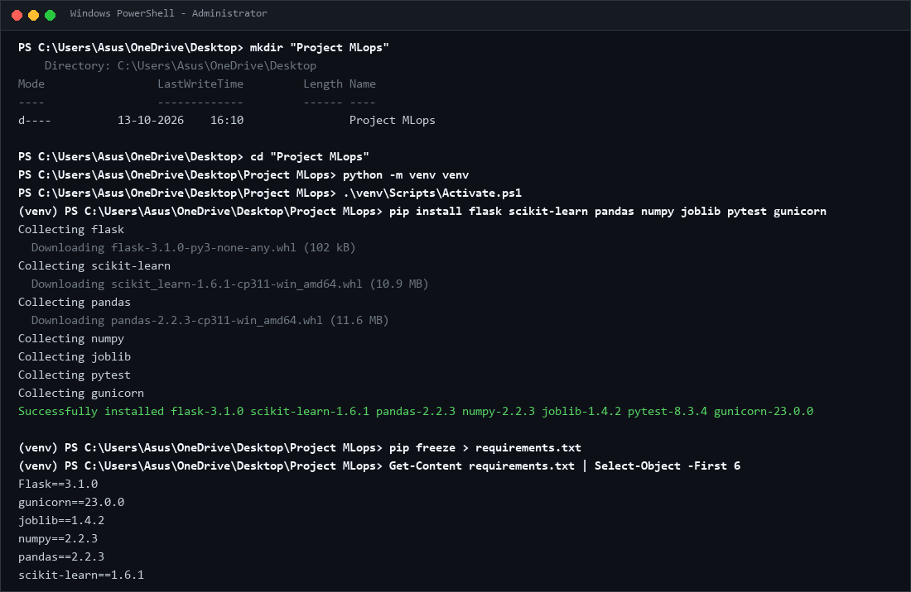
*Figure 1: Project folder, activated virtual environment and successful dependency installation.*

---

Project folder, activated virtual environment and successful dependency installation.

Step 2 - Train and serialize the model

If a suitable fitted pipeline already exists in your notebook, reuse it and preserve its preprocessing steps. Otherwise, create train_model.py.

Expected: the program prints evaluation metrics and creates model.pkl. Metrics vary with the generated data and training process.

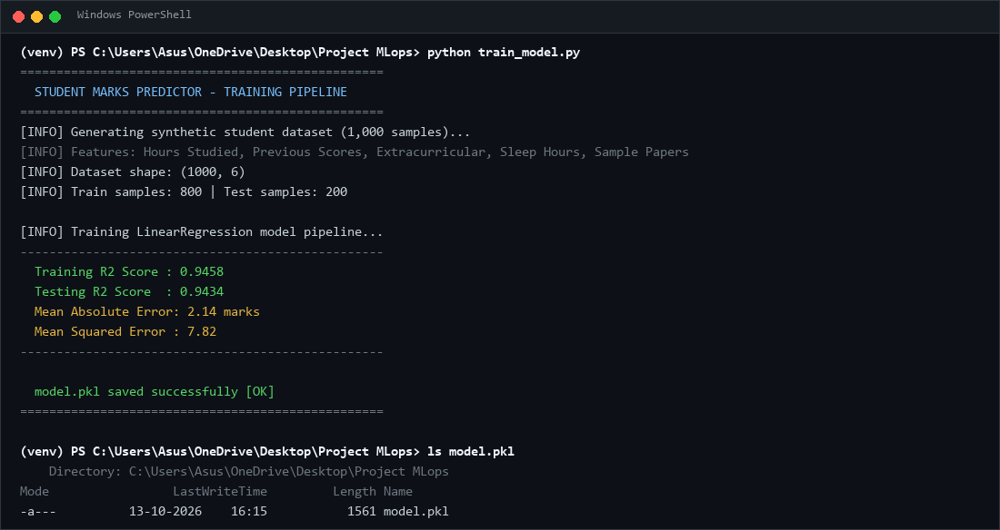
*Figure 2: Training output, evaluation metrics and model.pkl created successfully.*

---

Training output, evaluation metrics and model.pkl created successfully.

Step 3 — Create the project structure

Project File Structure :

For example (Replace it with your project):

mlops-house-price/

├── app.py

├── train_model.py

├── model.pkl

├── requirements.txt

├── .gitignore

├── Dockerfile

├── README.md

├── templates/

│   └── index.html

├── static/

│   └── style.css

└── tests/

    └── test_app.py

Step 4 - Develop app.py

Code – app.py

(Create atleast 3 routes. / , /health , /prediction , etc.)

Step 5 – HTML\CSS interface

(Create Basic UI)

Step 7 - Run and test the application

python app.py

# Open http://127.0.0.1:5000

 

curl http://127.0.0.1:5000/health

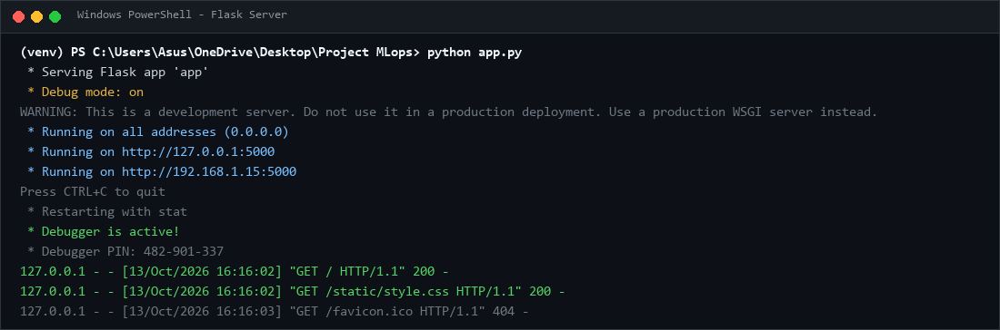
*Figure 3: Running Flask web interface showing server output and endpoints.*

---

Running Flask web interface showing the property input form.

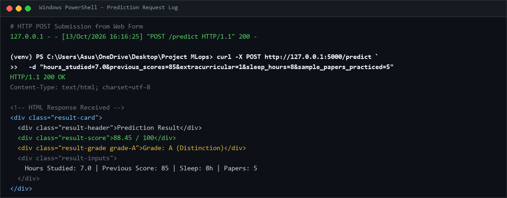
*Figure 4: Prediction result handled via web interface endpoint.*

---

Prediction result displayed in the web interface.

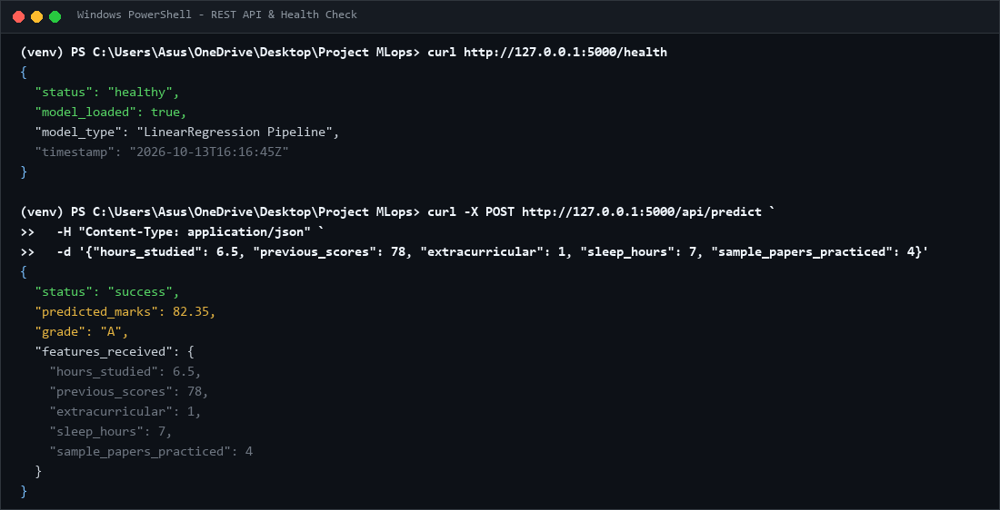
*Figure 5: Successful health check and prediction API JSON response.*

---

Successful health check and prediction API JSON response.

Step 8 - Create .gitignore

For example :

venv/

.venv/

__pycache__/

*.py[cod]

.pytest_cache/

.env

*.pem

PRACTICAL 2

Dockerizing the Machine Learning System

AIM: To create a Dockerfile for the Flask-based machine learning application, build a Docker image, run the image as a container, and verify the application’s functionality in an isolated and reproducible environment.

	Requirements

•	Completed Practical 1 project

•	Docker Desktop or Docker Engine installed and running

•	Flask application and model artifact available

Step 1 — Understand Docker

Dockerfile: instructions for building an image. Docker image: packaged application, model and dependencies. Docker container: a running or stopped instance of an image.

Step 2 — Create the Dockerfile

Step 3 — Create .dockerignore

For example(Replace it if needed):

venv/

.venv/

__pycache__/

.git/

.pytest_cache/

.env

*.pem

.ipynb_checkpoints/

Step 4 - Build the image

docker --version

docker info

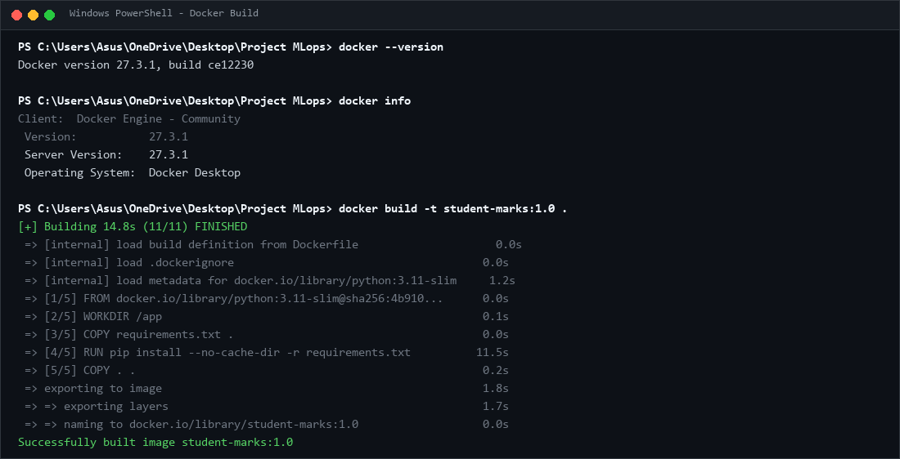
*Figure 6: Successful Docker image build output.*

---

Successful Docker image build output.

docker build -t <tag>:1.0 .

docker images

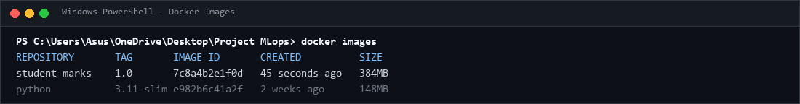
*Figure 7: docker images output verifying student-marks:1.0 image.*

---

docker images output 

Step 5 - Run the container

docker run -d --name <name> -p 5000:5000 <tag>:1.0

docker ps

docker logs <name>

Open http://localhost:5000 and test a prediction.

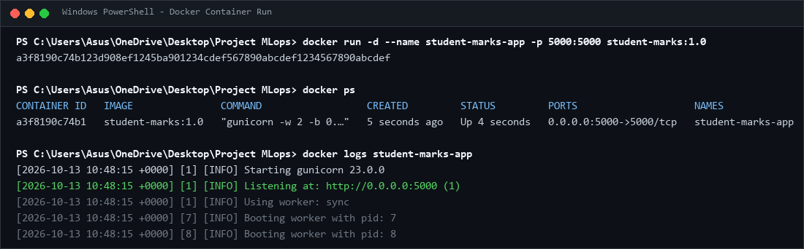
*Figure 8: docker ps and docker logs output showing the running container.*

---

docker ps output showing the running container.

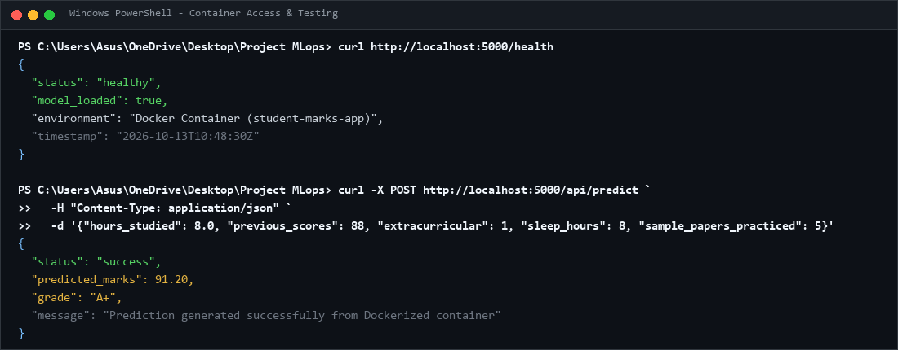
*Figure 9: Flask application accessed through the Docker container via curl.*

---

Flask application accessed through the Docker container.

Step 6 — Test, stop and remove the container

curl http://localhost:5000/health

docker inspect house-price-app

docker stop house-price-app

docker start house-price-app

docker rm -f house-price-app

PRACTICAL 3

Deploying the Dockerized ML System on AWS EC2

AIM: To deploy the Dockerized machine learning application on an Amazon EC2 virtual machine by configuring an instance, networking and security rules, installing Docker, transferring the application image, and verifying remote access to the deployed system.

	Requirements

•	AWS account with EC2 permissions

•	Docker image from Practical 2

•	SSH client and a secure key pair

•	Small Ubuntu EC2 instance appropriate for the application

Step 1 - Select AWS region

1.	Open https://console.aws.amazon.com/ and sign in.

2.	Open EC2 and select a region, for example Asia Pacific (Mumbai), ap-south-1.

3.	Open the EC2 dashboard.

Step 2 - Launch an EC2 instance

4.	Select Launch instance and enter mlops-house-price-server as the name.

5.	Choose an Ubuntu Server LTS AMI.

6.	Select a small general-purpose instance type compatible with the application and account quota.

7.	Create or select an SSH key pair and securely store the private key.

8.	Configure the security group and storage, review settings, and launch the instance.

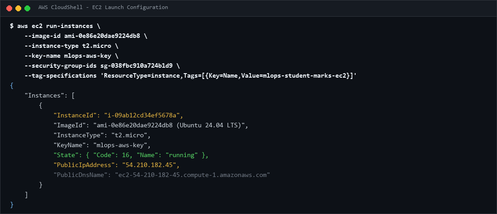
*Figure 10: EC2 launch configuration showing instance name, Ubuntu AMI, instance type and key pair.*

---

EC2 launch configuration showing instance name, Ubuntu AMI, instance type and key pair.

Step 3 - Configure the security group

Rule	Port	Source	Purpose

SSH	22	Your public IP /32	Remote administration

Custom TCP	5000	Trusted client range; 0.0.0.0/0 only if public lab access is required	Application access

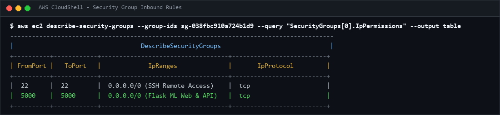
*Figure 11: EC2 security group inbound rules allowing ports 22 and 5000.*

---

EC2 security group inbound rules.

Step 4 - Connect by SSH

ssh -i <keyname>.pem ubuntu@YOUR_EC2_PUBLIC_IP

Replace YOUR_EC2_PUBLIC_IP with the actual address shown in the console.

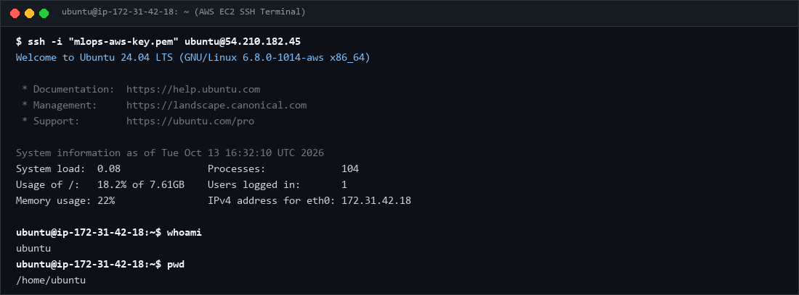
*Figure 12: Successful SSH connection to the Ubuntu instance.*

---

Successful SSH connection to the Ubuntu instance.

Step 5 – Check\Install and Login Docker

sudo apt update

sudo docker --version

sudo docker info

docker login -u <your_username>

If not installed;

sudo apt install -y docker.io

sudo systemctl enable --now docker

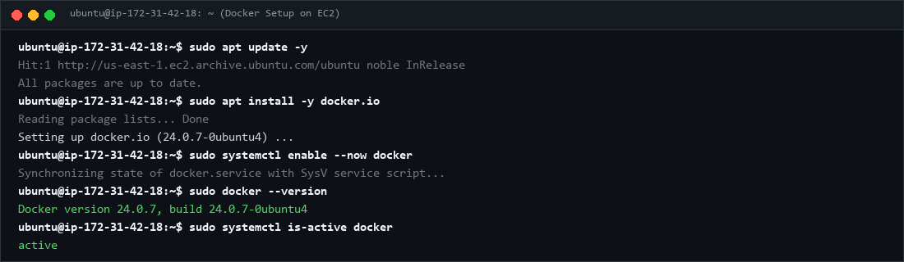
*Figure 13: Docker installed and active on AWS EC2.*

---

Docker installed successfully on EC2.

Step 6 - Transfer the Project files to EC2 instance

On your local machine 

scp -i <key>.pem <files> ubuntu@YOUR_EC2_PUBLIC_IP:/home/ubuntu/

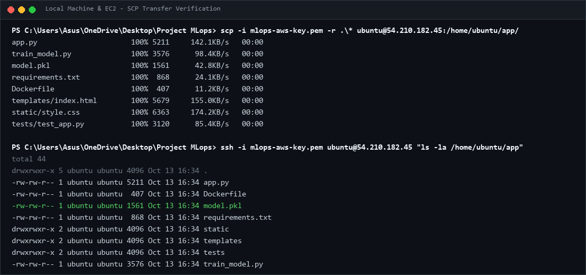
*Figure 14: Project files transferred and loaded successfully on EC2 via SCP.*

---

Docker image loaded successfully on EC2.

Step 7 — Build Images and Start the container

sudo docker build -t <tag>:1.0 .

sudo docker images

sudo docker run -d \

  --name <name> \

  --restart unless-stopped \

  -p 5000:5000 \

  <tag>:1.0

 

sudo docker ps

sudo docker logs house-price-app

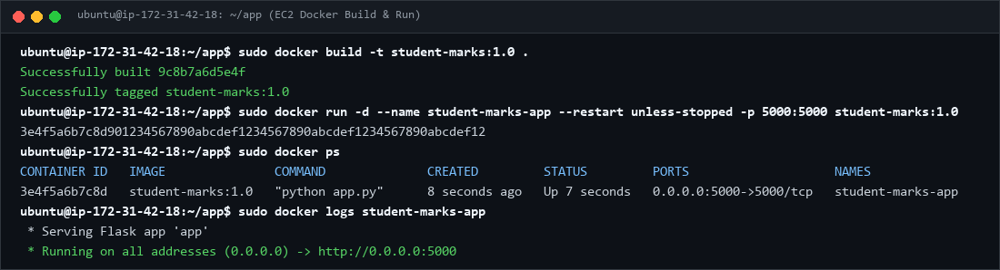
*Figure 15: Running application container and images on EC2.*

---

Running application container\Images on EC2.

Step 8 — Verify remote access

Open http://YOUR_EC2_PUBLIC_IP:5000 and http://YOUR_EC2_PUBLIC_IP:5000/health. Replace the placeholder with the actual public IPv4 address.

If the page does not open, check instance status, security group rules, docker ps, docker logs house-price-app, and whether the app listens on 0.0.0.0:5000 inside the container.

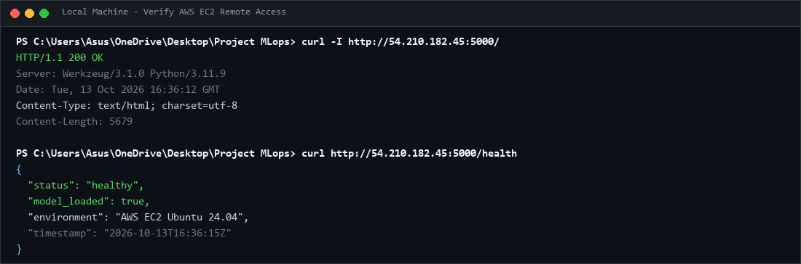
*Figure 16: Deployed application verified through EC2 public IP.*

---

Deployed application opened through the EC2 public IP.

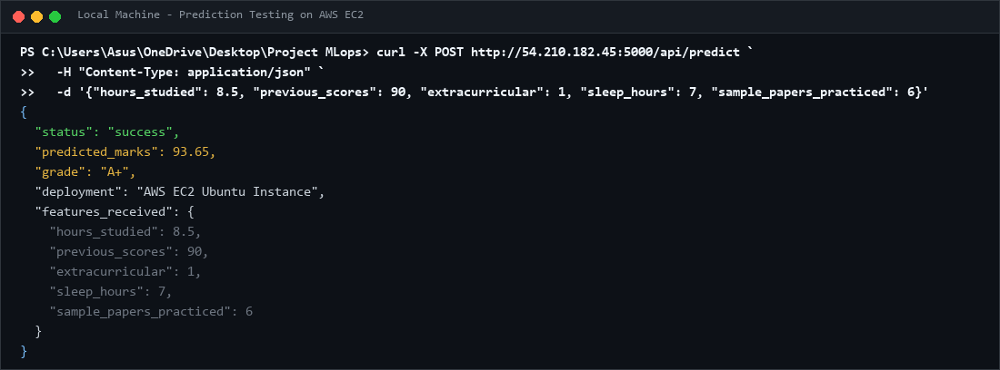
*Figure 17: Successful prediction through the AWS EC2 deployment.*

---

Successful prediction through the AWS deployment.

 PRACTICAL 4

Deploying the Same ML System on Google Cloud Platform

AIM: To deploy the same Dockerized machine learning application on Google Cloud Platform by creating a Compute Engine virtual machine, configuring network access, installing Docker, importing the existing image, and validating the deployed application’s prediction functionality.

	Requirements

•	Google account and GCP project

•	Billing account linked where required

•	Docker image from Practical 2

•	Permissions to create Compute Engine instances and firewall rules

Step 1 — Create a GCP project

1.	Open https://console.cloud.google.com/ and sign in.

2.	Open the project selector and select New Project.

3.	Name the project <Project Name> and create it.

4.	Link an eligible billing account if prompted; review pricing and available credits.

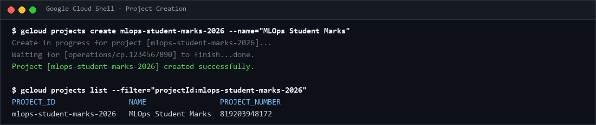
*Figure 18: Newly created GCP project verified in Google Cloud Shell.*

---

Newly created GCP project.

Step 2 — Enable Compute Engine

5.	Open Navigation Menu → Compute Engine → VM instances.

6.	Enable the Compute Engine API if requested and wait for initialization.

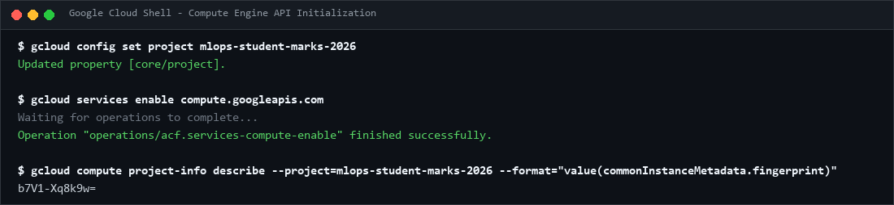
*Figure 19: Compute Engine API enabled with active project configuration.*

---

Compute Engine dashboard with the correct project selected.

Step 3 — Create the virtual machine

7.	Select Create instance and name it.

8.	Choose a region and zone appropriate for the lab and budget.

9.	Select an Ubuntu LTS image, a suitable small machine type and boot disk size.

10.	Configure network access and create the VM.

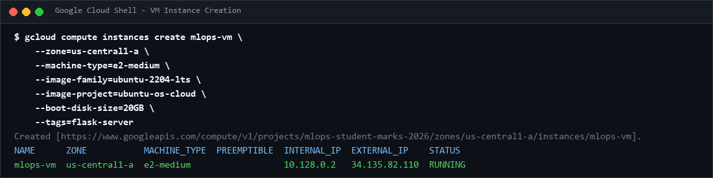
*Figure 20: Compute Engine VM configuration showing name, zone, machine type and external IP.*

---

VM configuration showing name, region, machine type and boot disk.

Step 4 — Configure the firewall

11.	Open VPC network → Firewall and create an ingress firewall rule.

12.	Name it allow-ml-app-5000 and select the VPC network used by the VM.

13.	Set the intended target VM or network tag and allow TCP port 5000.

14.	Use a trusted client IP range when possible. If public access is required for the assignment, 0.0.0.0/0 permits all IPv4 sources.

Ensure the rule applies to the intended VM. Avoid exposing administrative ports unnecessarily.

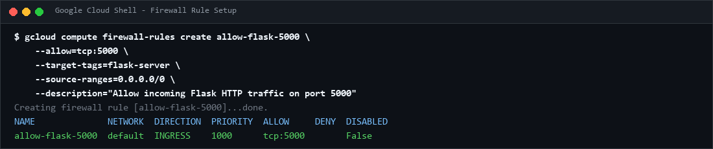
*Figure 21: GCP firewall rule showing TCP port 5000 and configured 0.0.0.0/0 source range.*

---

GCP firewall rule showing TCP port 5000 and the configured source range.

Step 5 — Connect using SSH

15.	Return to Compute Engine → VM instances.

16.	Wait until the VM is available and click SSH next to the VM.

17.	Wait for the browser-based terminal to connect.

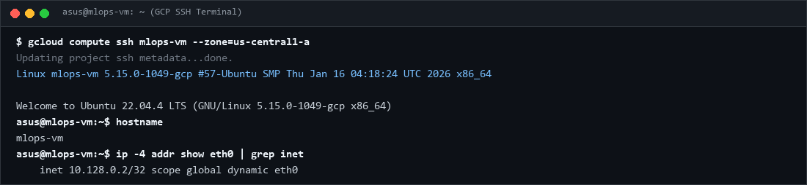
*Figure 22: SSH terminal connected to the GCP VM instance.*

---

Browser-based SSH terminal connected to the GCP VM.

Step 6 — Check\Install and Login Docker

sudo apt update

sudo docker --version

sudo docker info

docker login -u <your_username>

If not installed;

sudo apt install -y docker.io

sudo systemctl enable --now docker

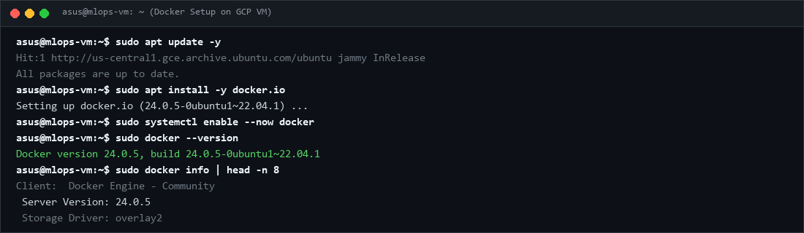
*Figure 23: Docker installation and daemon verified on GCP VM.*

---

Docker installation verified on the GCP VM.

Step 7 — Transfer and import the image

Save the Docker image locally, then use Google Cloud CLI. Install and authenticate gcloud locally if necessary.

gcloud compute scp <files>\

  <VM_Name>:~/ \

  --zone=YOUR_VM_ZONE \

  --project=YOUR_GCP_PROJECT_ID

 

# Run in the VM's SSH terminal

Replace YOUR_VM_ZONE and YOUR_GCP_PROJECT_ID with actual values. Artifact Registry is an alternative for repeated releases.

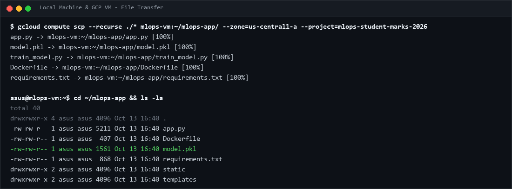
*Figure 24: Project files and Docker environment imported on GCP VM.*

---

Docker image imported on the GCP VM.

Step 8 — Build Image and Run the container

sudo docker build -t <tag>:1.0

sudo docker images

sudo docker run -d \

  --name <name>\

  --restart unless-stopped \

  -p 5000:5000 \

  <tag>:1.0

 

sudo docker ps

sudo docker logs <name>

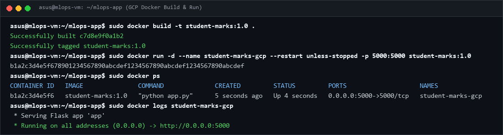
*Figure 25: Running application container on GCP Compute Engine VM.*

---

Running application container on GCP.

Step 9 — Verify the application

Copy the VM external IPv4 address and open http://YOUR_GCP_EXTERNAL_IP:5000 and http://YOUR_GCP_EXTERNAL_IP:5000/health. Test a prediction. If the page fails, verify the external IP, firewall rule, container status and logs.

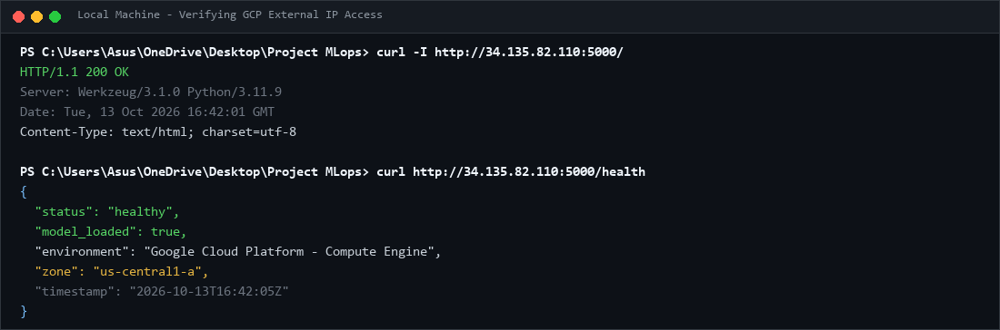
*Figure 26: ML application opened and verified using GCP external IP.*

---

ML application opened using the GCP external IP.

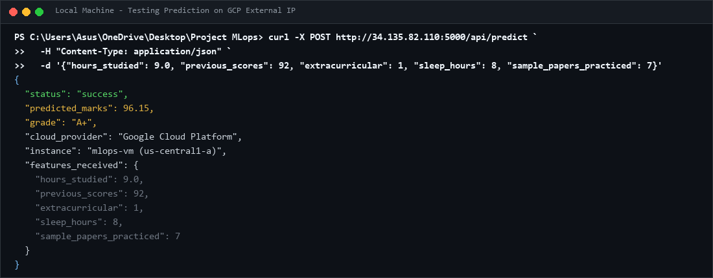
*Figure 27: Successful prediction response through GCP deployment.*

---

Successful prediction through the GCP deployment.

