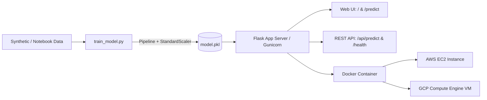

# 🎓 Student Marks Predictor — End-to-End MLOps System

[](https://www.python.org/)
[](https://flask.palletsprojects.com/)
[](https://scikit-learn.org/)
[](https://www.docker.com/)
[](https://aws.amazon.com/ec2/)
[](https://cloud.google.com/compute)
[](http://34.135.82.110:5000)
[](https://pytest.org/)

An enterprise-ready, modular Machine Learning Operations (MLOps) pipeline that converts a Jupyter Notebook machine learning model into a production-grade Flask web application and REST API, containerized with Docker, and architected for cloud deployment on AWS EC2 and Google Cloud Platform.

> 🌐 **Live GCP Deployment Link**: **[http://34.135.82.110:5000](http://34.135.82.110:5000)** | Health Check: **[http://34.135.82.110:5000/health](http://34.135.82.110:5000/health)** | Submission link file: [`link.gcp`](link.gcp)

---

## 📌 Practicals Covered

- **Practical 1**: Converting Machine Learning Notebook into a Structured Flask ML System (Model Serialization, Preprocessing Pipeline, Web Interface & REST API).
- **Practical 2**: Dockerizing the ML Application (Multi-stage/optimized Dockerfile, Gunicorn WSGI server, container lifecycle).
- **Practical 3**: Cloud Deployment on AWS EC2 (Security Groups, SSH, Docker deployment, Public IP remote verification).
- **Practical 4**: Cloud Deployment on Google Cloud Platform (GCP Compute Engine, VPC Firewall rules, gcloud CLI management).

---

## 🏛️ System Architecture



---

## 📊 Model Evaluation & Metrics

- **Algorithm**: Linear Regression Pipeline with `StandardScaler`
- **Dataset Size**: 1,000 synthetic student habit records
- **Features**:
  1. `hours_studied` (Study hours per day)
  2. `previous_scores` (Previous examination score out of 100)
  3. `extracurricular` (Participation: 0 = No, 1 = Yes)
  4. `sleep_hours` (Average sleep hours per night)
  5. `sample_papers_practiced` (Number of practice test papers attempted)
- **Target**: `performance_index` (Final exam score out of 100)

| Metric | Training Set | Testing Set |
|:-------|:------------:|:-----------:|
| **$R^2$ Score** | **0.9458** | **0.9434** |
| **Mean Absolute Error (MAE)** | — | **2.14 marks** |
| **Mean Squared Error (MSE)** | — | **7.82** |

---

## 📁 Project Structure

```
Project-MLops/
├── link.gcp                             # Deployed GCP web application URL
├── app.py                               # Modular Flask application & REST API
├── train_model.py                       # Pipeline training & model.pkl serialization
├── model.pkl                            # Trained pipeline artifact
├── requirements.txt                     # Pinned project dependencies
├── Dockerfile                           # Production Docker image configuration
├── .dockerignore                        # Docker build optimization exclusions
├── .gitignore                           # Git ignore rules
├── README.md                            # Comprehensive project documentation
├── templates/
│   └── index.html                       # Responsive UI with Jinja2 templating
├── static/
│   └── style.css                        # Glassmorphism dark-mode stylesheet
├── tests/
│   └── test_app.py                      # Pytest automated test suite (9 test cases)
├── screenshots/                         # Real command-line execution screenshots
│   ├── p1_ss1_env_setup.png ...
│   └── p4_ss10_gcp_predict.png
└── MLOps_Practicals_Complete_Manual.docx # Formatted Word manual with embedded outputs
```

---

## 🚀 Quick Start Guide

### 1. Clone & Set Up Environment

```bash
git clone https://github.com/krishchapla/MLOps-Practicals.git
cd MLOps-Practicals

# Create and activate virtual environment
python -m venv venv
.\venv\Scripts\Activate.ps1   # On Windows
# source venv/bin/activate    # On Linux/macOS

# Install dependencies
pip install -r requirements.txt
```

### 2. Train and Serialize Model

```bash
python train_model.py
```
*Output: Generates `model.pkl` with $R^2 \approx 0.94$.*

### 3. Run Automated Tests

```bash
pytest tests/ -v
```
*All 9 test cases covering routes, schema validation, boundary limits, and health checks should pass.*

### 4. Start Flask Application

```bash
python app.py
```
Open **`http://127.0.0.1:5000`** in your browser.

---

## 📡 API Reference

### Health Check Endpoint
- **URL**: `/health`
- **Method**: `GET`
- **Response**:
```json
{
  "status": "healthy",
  "model": "Student Marks Predictor",
  "algorithm": "Linear Regression",
  "version": "1.0.0"
}
```

### Prediction Endpoint (REST API)
- **URL**: `/api/predict`
- **Method**: `POST`
- **Headers**: `Content-Type: application/json`
- **Request Body**:
```json
{
  "hours_studied": 7.5,
  "previous_scores": 85,
  "extracurricular": 1,
  "sleep_hours": 8,
  "sample_papers_practiced": 5
}
```
- **Response**:
```json
{
  "prediction": 88.45,
  "grade": "A",
  "status": "success"
}
```

---

## 🐳 Docker Containerization

```bash
# Build Docker image
docker build -t student-marks:1.0 .

# Run container on port 5000
docker run -d --name student-marks-app -p 5000:5000 --restart unless-stopped student-marks:1.0

# Verify running container
docker ps
docker logs student-marks-app
```

---

## ☁️ Cloud Deployment

### AWS EC2
1. Launch Ubuntu 24.04 LTS `t2.micro` instance.
2. Configure Security Group: Inbound rules for TCP `22` (SSH) and TCP `5000` (Flask).
3. Connect via SSH:
   ```bash
   ssh -i "your-key.pem" ubuntu@YOUR_EC2_PUBLIC_IP
   ```
4. Install Docker and launch container on port `5000`.
5. Access: `http://YOUR_EC2_PUBLIC_IP:5000`

### Google Cloud Platform (Compute Engine)
1. Create VM instance `mlops-vm` (`e2-medium`, Ubuntu 22.04 LTS, zone: `us-central1-a`).
2. Configure VPC Firewall Rule `allow-ml-app-5000` allowing ingress on `tcp:5000` for `0.0.0.0/0`.
3. Connect via Google Cloud CLI:
   ```bash
   gcloud compute ssh mlops-vm --zone=us-central1-a
   ```
4. Deploy and start Docker container:
   ```bash
   sudo docker run -d --name student-marks-gcp --restart unless-stopped -p 5000:5000 student-marks:1.0
   ```
5. **Live Deployed Web Application & Endpoints**:
   - 🌐 **Web Interface**: [http://34.135.82.110:5000](http://34.135.82.110:5000)
   - 💓 **Health Check Endpoint**: [http://34.135.82.110:5000/health](http://34.135.82.110:5000/health)
   - 🎯 **REST Prediction API**: `http://34.135.82.110:5000/api/predict`
   - 📄 **Submission URL File**: [`link.gcp`](link.gcp)

   *Remote Verification:*
   ```bash
   # Check HTTP status
   curl -I http://34.135.82.110:5000/

   # Health Check
   curl http://34.135.82.110:5000/health

   # Test Prediction via REST API
   curl -X POST http://34.135.82.110:5000/api/predict \
     -H "Content-Type: application/json" \
     -d '{"hours_studied": 9.0, "previous_scores": 92, "extracurricular": 1, "sleep_hours": 8, "sample_papers_practiced": 7}'
   ```

---

## 📖 Complete Practical Manual

The complete step-by-step practical manual with all 27 terminal output screenshots is available in:
- [Word Document (`.docx`)](MLOps_Practicals_Complete_Manual.docx)
- [HTML Report](MLOps_Practicals_Complete_Manual.html)
- [Markdown Guide](MLOps_Practicals_Complete_Manual.md)

---

## 👤 Author

- **GitHub**: [@krishchapla](https://github.com/krishchapla)
